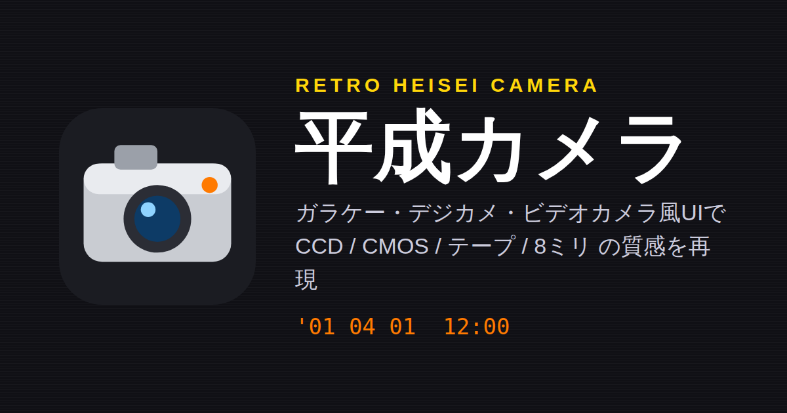

# 📷 平成カメラ

ガラケー・デジカメ・ビデオカメラ・テレビカメラ風の画面で、平成のころの写真や映像の質感を再現する、ブラウザで動くレトロカメラです。

**▶ https://higashiikenaga.github.io/heisei_camera/**

インストール不要・無料です。撮影した写真や動画は端末の中だけで処理され、外部のサーバーには送信しません。



## 主な機能

### 質感(ルック)

| ルック | 再現している特徴 |
|---|---|
| CCD コンデジ(2002) | 濃い発色、強い光源から縦に伸びる光の筋(スミア)、白飛び周りのにじみ、色ノイズ、周辺減光 |
| CMOS ケータイ(2008) | カメラを振ると画面が斜めに歪むローリングシャッター、暗部ノイズ、縦横の縞ノイズ、ホットピクセル |
| 8ミリフィルム風 | 粒子、明るさのちらつき、傷・ほこり、暖色寄りの色 |
| アナログテープ(ホームビデオ風) | 横に滲む色、走査線、流れるノイズ帯、画面下部の揺れ |
| デジタルテープ(ハンディ型風) | WebGL シェーダーによる 4:2:0 風の色にじみ、まれに数フレームだけ出るブロックノイズ |
| テレビカメラ(2008) | インターレースの櫛状ノイズ、輪郭強調、ハイライトを寝かせるニー処理 |

画面の上下をぼかしてジオラマのように見せる **チルトシフト(ミニチュア風)** は、どのルックにも重ねて使えます。画面をタップすると、ピントの合う位置を動かせます。

### デザイン(本体の見た目)

設定の「デザイン」から 8 種類を選べます。選んだデザインに合わせて、ルックも自動で切り替わります。

- **ガラケー風**: ブラック(折りたたみ)、シルバー(ストレート)、ピンク(ギャル系)
- **デジカメ風**: シルバー、ブラック
- **ビデオカメラ風**: デジタルテープ、アナログテープ
- **テレビカメラ風(2000年代後半)**: ゼブラ表示(白飛び警告)、セーフエリア枠、タイムコードを表示します。ゼブラと枠は画面表示だけで、録画・写真には入りません。

スマホ(縦・横)、タブレット、PC のどの画面サイズでも使えます。

### 撮影

- 写真(JPEG)と動画(WebM、非対応のブラウザでは MP4)
- 撮影比率: 16:9 / 4:3 / 1:1 / 全画面
- シャッター音、録画開始の「ピッ」・停止の「ピピッ」
- 録音にテープ風のヒスノイズ・ワウフラッター・ポップノイズを合成
- 日付の写し込み、デジタルズーム(ピンチ操作にも対応)、グリッド表示、前面/背面カメラの切り替え

## 操作方法

| 操作 | 画面のボタン | ガラケー風のキー | PC のキーボード |
|---|---|---|---|
| 撮影 / 録画の開始・停止 | シャッター | 十字キーの中央 | Enter / Space |
| ルック切り替え | ルック名のボタン | ◀ ▶ / 0 | ← → |
| ズーム | 1× 2× 4× | ▲ ▼ / 7 8 | ↑ ↓ |
| 比率 | 16:9 などのボタン | 1 2 3 9 | — |
| 写真 / 動画の切り替え | 写真・ビデオ | 4 5 / 写真/動画 | — |
| 設定 | ⚙ | メニュー / ＊ | — |
| 更新履歴・連絡先 | 設定 → ℹ️ | ＃ | — |

## 動作環境

- カメラを使うため、**HTTPS** または `localhost` で開く必要があります(GitHub Pages は HTTPS です)。
- 最近の Chrome / Edge / Safari / Firefox で使えます。
- デジタルテープ風のルックには WebGL が必要です。WebGL が使えない環境では、このルックは表示されません。
- iOS Safari では、動画の保存形式が MP4 になる場合があります。

## ローカルで動かす

ビルドは不要です。ファイル一式を簡易サーバーで配信するだけで動きます。

```sh
git clone https://github.com/higashiikenaga/heisei_camera.git
cd heisei_camera
python3 -m http.server 8000
# ブラウザで http://localhost:8000 を開く
```

## ファイル構成

```
index.html             アプリ本体(HTML / CSS / JavaScript を 1 ファイルに収録)
favicon.svg, *.png     ファビコン・アプリアイコン・OGP 画像
manifest.webmanifest   ホーム画面に追加したときの設定
robots.txt, sitemap.xml
```

更新履歴は、アプリの「設定 → ℹ️ 更新履歴・作者連絡先」から見られます。中身は `index.html` 内の `HISTORY` 配列です。

## 作者

- GitHub: [higashiikenaga/heisei_camera](https://github.com/higashiikenaga/heisei_camera)
- メール: sanyokai05@gmail.com
